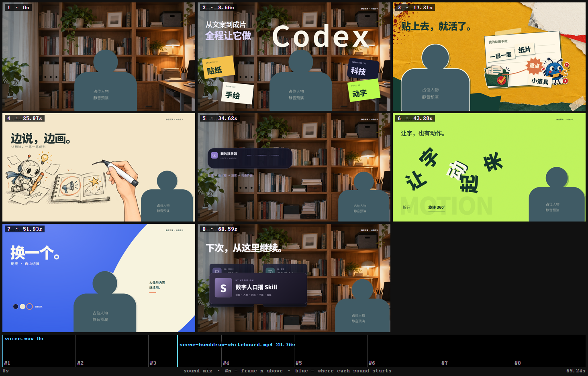

# Codex 数字人口播动画 Skill

用自己的文案与数字人，制作带贴纸、连续手绘、科技卡片、动态大字和背景切换的动画口播。示例为16:9横屏、1080P，主字幕放下方，半身人物下沿贴底。

**第一次领取：[下载完整包 ZIP](https://github.com/Ewantang-ai/codex-style-showcase/releases/latest/download/codex-style-showcase-v1.1.0.zip) · [查看版本与附件](https://github.com/Ewantang-ai/codex-style-showcase/releases/latest)**

下载完整ZIP后解压，不要只复制一个SKILL.md。若上面的直接下载链接不可用，请打开版本页，在Assets中选择`codex-style-showcase-v1.1.0.zip`。

## 怎么开始

1. 先看[先读我](00_先读我.md)和[新手使用说明](02_新手使用说明.md)。
2. 把整个文件夹交给电脑端Codex，复制[这段启动提示](01_直接发给Codex.txt)。先检查环境，跑不调用付费服务的静音示例。
3. 有口播MP4就直接导入；没有则按[蝉镜流程](chanjing.md)用自己的账号、形象与声音生成。
4. 换文案、素材与时间锚点，制作、预览并导出。正式结果仍需试听和运动检查。

也可运行`安装Skill.ps1`安装到本机Codex，旧版会先备份。重开聊天调用`$codex-style-showcase`。

## 包含哪些效果

| 风格 | 具体效果 |
|---|---|
| 贴纸手账 | 纸片、胶带与人物分层贴入，柔和停靠，引导线画到重点再强调 |
| 连续笔迹手绘 | 插画按语义分区，真实连续落墨、添彩与停留 |
| 科技交互 | 卡片前后景绕行，胶囊连续变为播放器、进度和界面 |
| 动态大字 | 完整360°旋转、实际字序重排、上下穿插再归位 |
| 背景与字幕 | 书房/纸面/色块切换，人像声音连续，下方字幕逐字高亮 |

下图来自包内的**静音占位试跑**，没有真人脸和声音。

## 完整包结构

可编辑代码、脚本与素材都在上方Release ZIP中；本仓库首页和说明文件用于浏览与领取。

- `codex-style-showcase/SKILL.md`（在完整ZIP内）：给Codex读取的制作入口。
- [风格与提示词](styles.md)：选风格、生成素材、动作与版面标准。
- [安装与试跑](setup.md)：环境、依赖和首次运行。
- [素材到成片](production.md)：抠像、真实ASR、字幕、分镜与导出。
- [验收和排错](quality.md)：常见问题与实际检查。
- `assets/template`：可编辑代码、锚点、字体、背景和示例手绘。
- `scripts`：环境诊断、初始化、素材处理、ASR适配、白板渲染与完整解码。

## 需要自己准备

Codex及文件/命令工具、Node/Python/FFmpeg；新数字人需要自己的蝉镜账号与可用形象/声音，真实对齐需要ASR服务或本地模型，换新插画需要可用图像生成能力。详见安装说明。

这是流程、模板和脚本包，不附平台积分、ASR模型或付费服务，不是任意聊天框都能免费一键出片的软件。蝉镜网页路径已整理；MCP/API仅附可选接入说明，未配置或测试连接。

## 版本与反馈

当前v1.1.0。独立Windows环境试跑、对齐构建、绿幕带声测试、白板渲染、片段导出和包完整性检查范围见[验证说明](04_验证说明.md)。其他系统未作实体机验收。

反馈请带版本、系统、当前步骤和错误文字；不要发口令、验证码或API密钥。包内不含制作者真人素材、声音与账号信息。

## 来源与使用

原创流程与模板可按包内[使用说明](素材许可.md)复用。白板渲染器保留原作者MIT许可，字体保留OFL许可；不要把第三方内容声称为独立原创。生成图片记录了来源，不承诺排他版权或视频流量收益。
